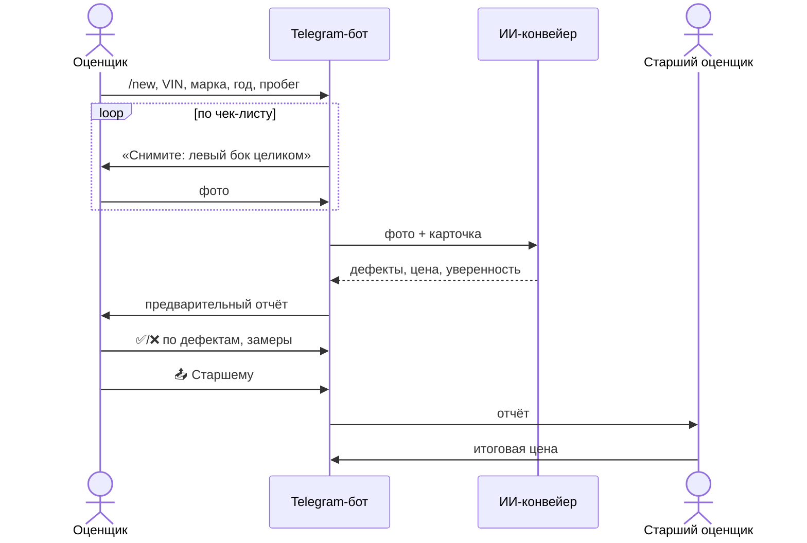

# 2. Продукт, UX и дизайн

Оценщикам, которые работают на площадке с телефоном в руках, нужен **Telegram-бот**, а не сайт.

## Путь оценщика

1. Создаёт карточку: VIN или госномер, марка, год, пробег. *(бот: `/new`)*
2. Бот ведёт по чек-листу («Сфотографируйте левое переднее крыло», «Откройте капот») и сам запрашивает недостающие ракурсы.
3. Фото загружаются, через 1–3 минуты приходит предварительный отчёт.
4. Оценщик подтверждает или отклоняет каждый найденный дефект (кнопки ✅/❌) и добавляет то, что ИИ не увидел: замеры толщиномера, ошибки OBD (кнопка «✍️ Замер / OBD»).
5. Старший оценщик утверждает итоговую цифру (кнопка «📤 Старшему» → «🟢 Утвердить цену»). **Финальное решение всегда за человеком.**

Отправить старшему можно только после того, как все дефекты подтверждены или отклонены: так ни одна находка ИИ не уйдёт в итог без взгляда человека.

## Веб-панель руководства

История оценок, статистика ошибок, сравнение «оценка ИИ против реального результата продажи».

- Собирается в Appsmith или ToolJet поверх Supabase, без своего фронтенда.
- Данные для сравнения: представление `report_accuracy` (см. `supabase/migrations/0001_init.sql`).
- Итог продажи вносится в таблицу `outcomes`: цена продажи и что всплыло после.

*Пока не сделано:* сама панель (собирается в конструкторе за 1–2 дня, когда будут реальные данные).
