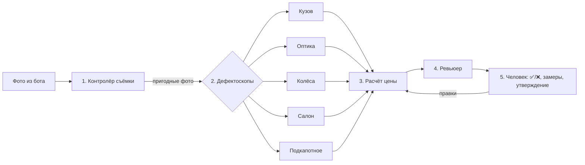

# 3. Технический стек и интеграции

Пилот обойдётся примерно в $0–50 в месяц на этом стеке.

| Слой | Решение | Статус в проекте |
| --- | --- | --- |
| Интерфейс | Telegram-бот (+ позже Mini App: галерея фото и отчёт) | Бот готов: `src/carval/bot/` |
| Оркестрация | n8n self-host на VPS (~$5–10/мес) | Для прототипа не нужна, см. `n8n/README.md` |
| БД и фото | Supabase (Postgres, Storage, Auth) | Схема: `supabase/migrations/0001_init.sql` |
| ИИ | Claude API с vision: анализ фото и отчёт | `src/carval/llm.py` |
| Первая проверка фото | Дешёвая быстрая модель | Claude Haiku (`CARVAL_MODEL_FAST`) |
| Админка | Appsmith или ToolJet поверх Supabase | Не начата |
| Данные рынка | Аналоги с kolesa.kz и подобных площадок | На старте вручную: `config/comparables.csv` |

**Про данные рынка.** Условия использования площадок могут ограничивать парсинг. Поэтому на старте цены аналогов вносятся вручную или берутся из внутренней базы заказчика.

**Про первую проверку.** В документе для неё предложен Gemini Flash. В проекте стоит Claude Haiku, чтобы на старте был один поставщик и один ключ. Модель меняется в `.env`.

## «Команда агентов» на практике

Не десять автономных агентов, а конвейер специализированных шагов с человеком в конце.

| Шаг | Роль | Задача | Код | Модель |
| --- | --- | --- | --- | --- |
| 1 | Контролёр съёмки | Все ли обязательные ракурсы есть, не размыты ли фото | `checklist.py` + `pipeline/shot_controller.py` | код + быстрая |
| 2 | Дефектоскопы по зонам | Кузов, стёкла и оптика, колёса, салон, подкапотное | `pipeline/inspector.py` | основная, параллельно по зонам |
| 3 | Оценщик | Аналоги, вычет на ремонт, диапазон цены | `pricing.py` | без ИИ: деньги считает код |
| 4 | Ревьюер | Перепроверяет находки, ищет противоречия, помечает неуверенность | `pipeline/reviewer.py` | основная |
| 5 | Человек | Утверждает итог | `bot/handlers.py` | — |



Пометку «проверить вручную» ставит правило в `pipeline/decision.py`. Это бизнес-решение, его нужно согласовать с заказчиком.

## Как «обучить»

Это не файнтюнинг, а **калибровка**. Нужны:

- чек-листы и прайс на ремонт заказчика → `config/checklist.yaml`, `config/repair_prices.csv`;
- **50–200 прошлых сделок с фото, оценкой и реальным итогом**: по ним измеряем, где ИИ ошибается, и подбираем примеры для промптов → `data/cases/`, запуск `python -m carval.backtest`;
- регулярный разбор расхождений и обновление промптов → `prompts/`.

Без исторических данных заказчика делать систему «вслепую» нельзя.

## Структура кода

```
src/carval/
  settings.py        настройки из .env
  models.py          машина, фото, дефект, оценка, отчёт
  catalog.py         загрузка config/ (чек-лист, дефекты, прайс, аналоги)
  checklist.py       полнота съёмки (без ИИ)
  pricing.py         цена (без ИИ)
  llm.py             вызов Claude: фото → проверенный JSON
  storage.py         локально или Supabase
  report.py          текст отчёта для Telegram
  pipeline/          шаги конвейера + decision.py
  bot/               Telegram-бот
  backtest.py        калибровка на прошлых сделках
```
